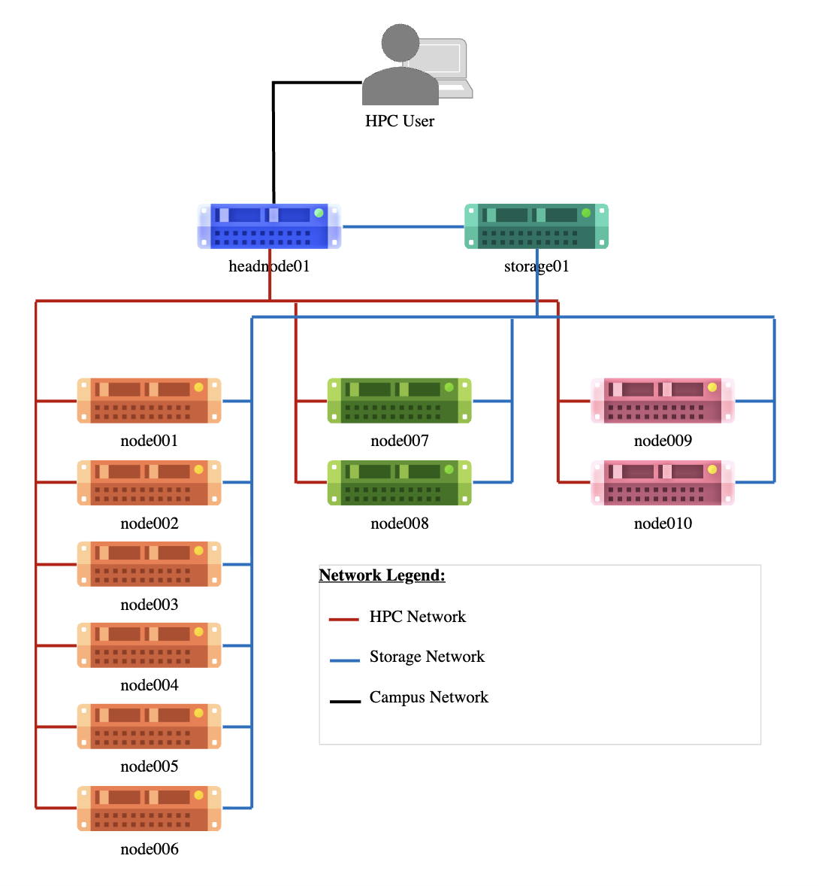

# GES-Petrarch HPC Cluster
This cluster was built by RCaaS HPC Engineers with hardware provided by the School of Geography and Earth Sciences within the College of Science and Engineering at the University of Glasgow in 2023-2024.

## Technology

All servers of the cluster run on Oracle Linux 9. Oracle Linux (OL) is a Red Hat based open-source operating system.

The cluster's scheduler is the Slurm Workload Manager, developed by SchedMD. This software is crucial for HPC and helps achieve fair usage of all available compute resources.

The cluster and storage mounted on to the system are located in Glasgow.

### Compute Resources

There are three types of nodes in the MARS cluster for processing different workloads!

#### Small Nodes
|||
|---|---|
|**Count**|6|
|**Specifications**|2x EPYC 7763 Processor @ 2.45 GHz 64 cores per CPU 1 TB RAM - 3200 MHz DDR4|
|**Hostnames**|node001 – 006|

#### Large Nodes
|||
|---|---|
|**Count**|2|
|**Specifications**|2x EPYC 7763 Processor @ 2.45 GHz 64 cores per CPU 2 TB RAM - 3200 MHz DDR4|
|**Hostnames**|node007 – 008|

#### GPU Nodes
|||
|---|---|
|**Count**|2|
|**Specifications**|1x Ryzen ThreadRipper PRO 5975WX Processor @ 3.6 GHz 32 cores per CPU 512 GB RAM - 3200 MHz DDR4 2x NVIDIA RTX 6000 Ada -48 GB GDDR6 - 18176 Cuda Cores|
|**Hostnames**|node009 – 010|

### System Layout

